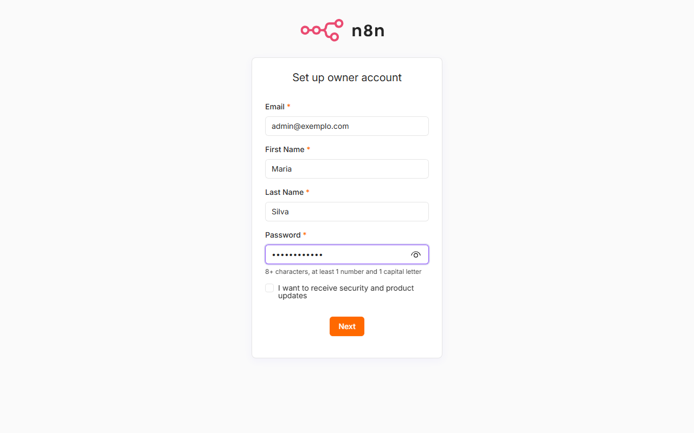
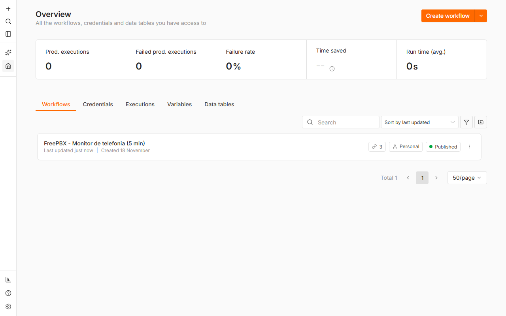
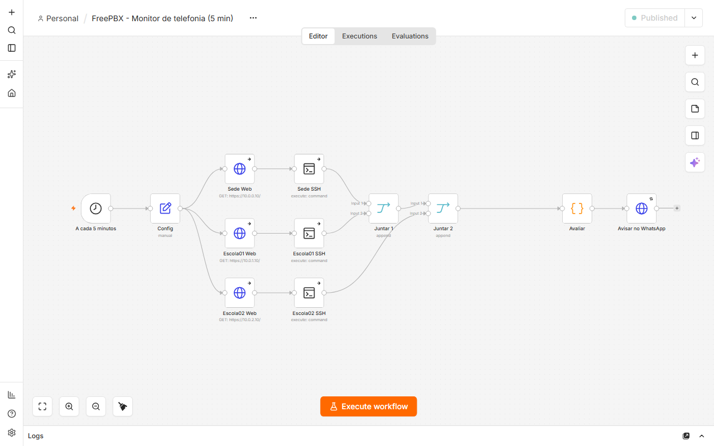
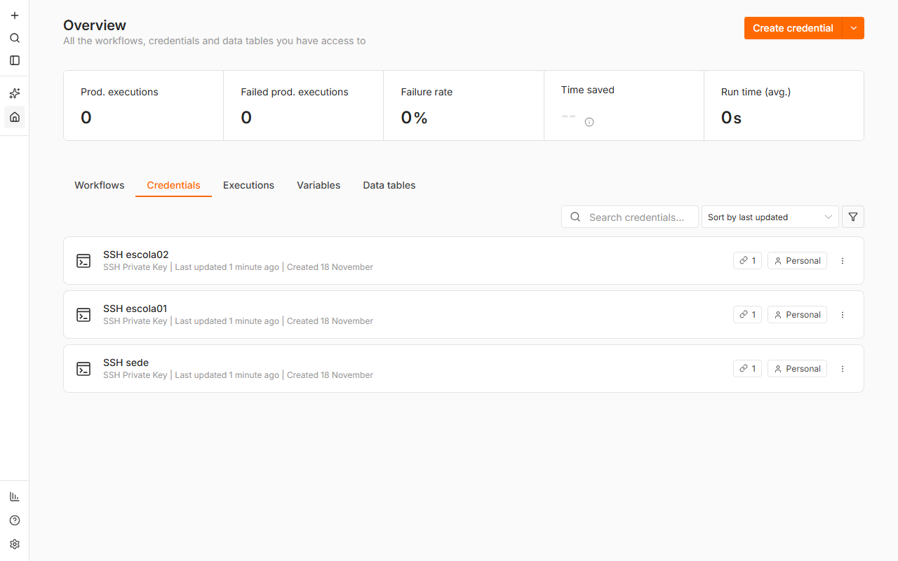
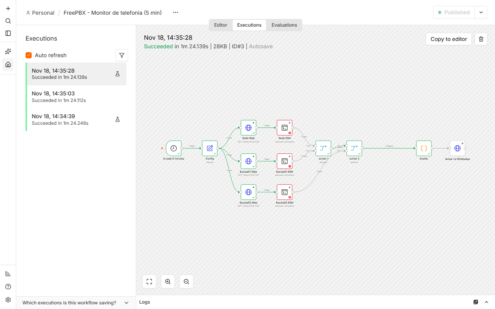

# Conhecer o painel do n8n

[⬅ Início](index.md) | Anterior: [Ligar o WhatsApp](whatsapp.md)

O **n8n** é o programa que faz o monitor funcionar. Ele tem um **painel**, uma página que você abre no navegador, onde dá para ver se o monitor está **ligado** e se as verificações estão acontecendo. Você **não precisa mexer em nada** lá: é só para olhar. Palavras novas estão no [Glossário](glossario.md).

**Atenção:** o painel do n8n está **em inglês**. Esta página traduz os nomes.

| 📋 Você vai precisar | Onde conseguir |
|---|---|
| ☐ A instalação concluída | Página [Instalação](instalacao.md) |
| ☐ O **IP do servidor** do monitor | Com o responsável pelo servidor |
| ☐ Um **e-mail** e uma **senha nova** para a conta de administrador | Você escolhe (veja o Passo 1) |
| ☐ Um navegador (Edge, Chrome ou Firefox) | Já no computador |

> **Sobre os prints:** foram tirados num ambiente de teste. Os nomes de central que aparecem neles (`sede`, `escola01`, `escola02`) e os IPs são **exemplos**; na sua instalação aparecerão os nomes e IPs da **sua** planilha.

## O que significa cada palavra do painel

| No painel (inglês) | Em português |
|---|---|
| **Workflows** | Fluxos: cada "roteiro" que o n8n executa. O nosso é "FreePBX - Monitor de telefonia (5 min)" |
| **Published** | **Ligado e funcionando** |
| **Credentials** | Credenciais: os "acessos" cadastrados (um por central) |
| **Executions** | Execuções: o histórico de cada vez que o monitor rodou |
| **Succeeded** | Deu certo (o fluxo rodou até o fim) |
| **Execute workflow** | Rodar agora, uma vez |

## Passo 1. Abrir o painel e criar a conta de administrador

1. No navegador, digite o endereço do painel: `http://IP-DO-SERVIDOR:5678` (troque pelo IP do servidor, por exemplo `http://10.0.0.5:5678`) e aperte Enter.
2. Na **primeira vez**, aparece a tela **Set up owner account** (criar a conta do dono). Preencha:

| Campo | O que escrever |
|---|---|
| **Email** | O e-mail da pessoa responsável pelo monitor |
| **First Name** | O nome |
| **Last Name** | O sobrenome |
| **Password** | Uma senha nova, com **8 ou mais caracteres, pelo menos 1 número e 1 letra maiúscula**. Guarde em um gerenciador de senhas |
| *I want to receive security and product updates* | Pode deixar **desmarcado** |

Depois de preencher tudo, clique em **Next**. Se aparecerem perguntas sobre o seu perfil, pode pular ou fechar.

**✅ Como saber que deu certo:** você entra no painel e vê a tela **Overview** (visão geral).

**⚠️ Se der errado:** se a página não abrir, confira o IP e a porta (**:5678**), e se o seu computador está na rede (ou VPN) do servidor. Se pedir *e-mail e senha* em vez de *criar conta*, a conta já foi criada por outra pessoa: peça a ela o acesso.

## Passo 2. Ver se o monitor está ligado

Na tela inicial, a aba **Workflows** mostra o nosso fluxo:

**✅ Como saber que deu certo:** o fluxo **"FreePBX - Monitor de telefonia (5 min)"** aparece com a etiqueta verde **Published** (ligado).

**⚠️ Se der errado:** se **não** estiver como *Published*, o WhatsApp ainda não foi ligado. Volte à página [Ligar o WhatsApp](whatsapp.md) e termine.

## Passo 3. Entender o desenho do monitor (opcional)

Clique no nome do fluxo para abri-lo. Você verá as "caixas" que o monitor executa, da esquerda para a direita:

| Caixa | O que faz |
|---|---|
| **A cada 5 minutos** (relógio) | Dá a partida a cada 5 minutos |
| **Config** | Guarda as configurações (limites e dados do WhatsApp) |
| ***Nome* Web** (uma por central) | Confere se o painel da central abre |
| ***Nome* SSH** (uma por central) | Entra na central, só para **ler** um relatório |
| **Juntar** | Junta os resultados de todas as centrais |
| **Avaliar** | Decide se há problema e monta a mensagem |
| **Avisar no WhatsApp** | Manda a mensagem ao grupo |

**Não mexa** em nenhuma caixa. Para voltar, clique em **Overview** (casinha) ou na seta do navegador.

## Passo 4. Ver as credenciais (opcional)

Na tela inicial, clique na aba **Credentials**. Há uma credencial para cada central (**SSH sede**, **SSH filial01**...):

São os "acessos de leitura" que o instalador cadastrou. **Não apague nem edite.**

## Passo 5. Ver se o monitor está rodando (execuções)

Abra o fluxo e clique na aba **Executions** (no alto, no meio). Cada linha é uma vez que o monitor rodou:

**✅ Como saber que está tudo certo:** aparecem execuções **Succeeded**, uma a cada 5 minutos, com a data e a hora.

### Como ler as cores das caixas

No desenho de uma execução:

- **Caixa com ✔ verde:** aquela etapa funcionou.
- **Caixa SSH com ✖ vermelho:** o n8n **não conseguiu entrar naquela central** para ler o relatório. O fluxo todo aparece como *Succeeded* mesmo assim, porque o monitor foi feito para não parar quando uma central falha.

**Na figura acima** (um exemplo de teste, com IPs de mentira) as caixas SSH estão vermelhas de propósito. **Na sua instalação, com as centrais certas, todas as caixas devem ficar verdes.**

**⚠️ Se uma caixa SSH ficar vermelha na sua instalação:** o monitor perdeu o acesso àquela central. No terminal, rode `sudo ./monitor/instalar.sh --verificar` (página [Instalação](instalacao.md), Passo 7): ele diz o motivo. Enquanto isso, o aviso do WhatsApp dirá "Sem acesso SSH" para aquela filial.

## Botão "Execute workflow"

No fluxo aberto, o botão laranja **Execute workflow** (embaixo) roda o monitor **agora**, uma vez. Não é necessário: ele já roda sozinho a cada 5 minutos. Pode apertar se quiser ver o resultado na hora. Só tenha em mente que, se houver um problema acontecendo naquele momento, pode chegar **um aviso a mais** no grupo.

## O que NÃO fazer no painel

- ❌ Apagar o fluxo, as credenciais ou as caixas.
- ❌ Desligar o fluxo (a opção **Unpublish**, no menu ao lado do botão **Published**) sem querer desligar o monitor.
- ❌ Compartilhar o endereço do painel ou a senha. Só a equipe responsável deve acessar.
- ❌ Deixar o endereço aberto na internet: o painel usa `http` (sem criptografia) e deve ser acessado **só pela rede interna**.

## Pronto?

- ☐ Criei a conta de administrador e guardei a senha com segurança.
- ☐ O fluxo está **Published**.
- ☐ Em **Executions** aparecem execuções **Succeeded** a cada 5 minutos.
- ☐ Sei que caixa SSH vermelha significa "não consegui entrar naquela central".

**Parabéns, o monitor está instalado e funcionando!** Para o dia a dia, guarde a página [Instalação](instalacao.md) (seção "Depois: mudar a lista de filiais").

